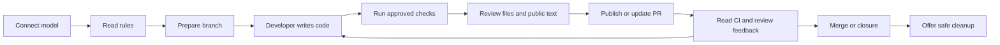

# Project Design

## Purpose

Layman is a CLI for GitHub contributions. It manages workflow tasks. The developer writes code and answers review feedback.

## Architecture

- The CLI starts or resumes a contribution, or finds a project. It shows the current step and next action.
- The provider layer connects to a required LLM. Use supported OAuth, an API key, or a local endpoint.
- The policy layer reads repository rules and templates. It validates model proposals against source text.
- The workflow layer controls Git actions, checks, and GitHub submissions.
- The state layer saves sessions and pending actions. It reconciles uncertain results before retry.
- The follow-up layer reads CI results, review feedback, and PR state.

## Contribution Flow

## Control Boundaries

The model explains rules and drafts text. Code validates evidence and controls actions. The developer approves commands and publication. Personal agreements and maintainer decisions stay with the developer.

Fixed CLI text and model explanations follow the Caveman voice contract. Technical payload stays exact. Public drafts follow repository conventions.

Panels show saved context. Check summaries preserve failed, skipped, waiting, and unknown states. Logs remain available as details.
Publication review shows the exact destination, files, and public text. Git terms receive one explanation per CLI run.

Confirmed failures block publication. Unknown requirements need review. New content invalidates prior evidence. Undo acts only on verified owned resources and keeps unmerged commits.

## Data Flow

Rules, intent, selected changes, and check evidence go to the selected model. Git sends approved commits to the verified remote. GitHub receives approved issue and PR text.

Store credentials, sessions, and briefs in private files outside the target repository. Keep status and safe recovery available when the model is unavailable.
